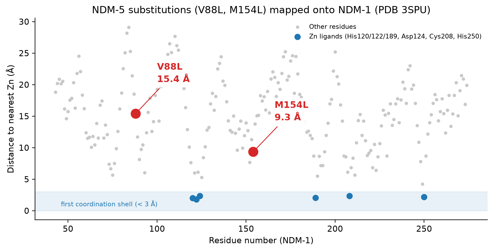
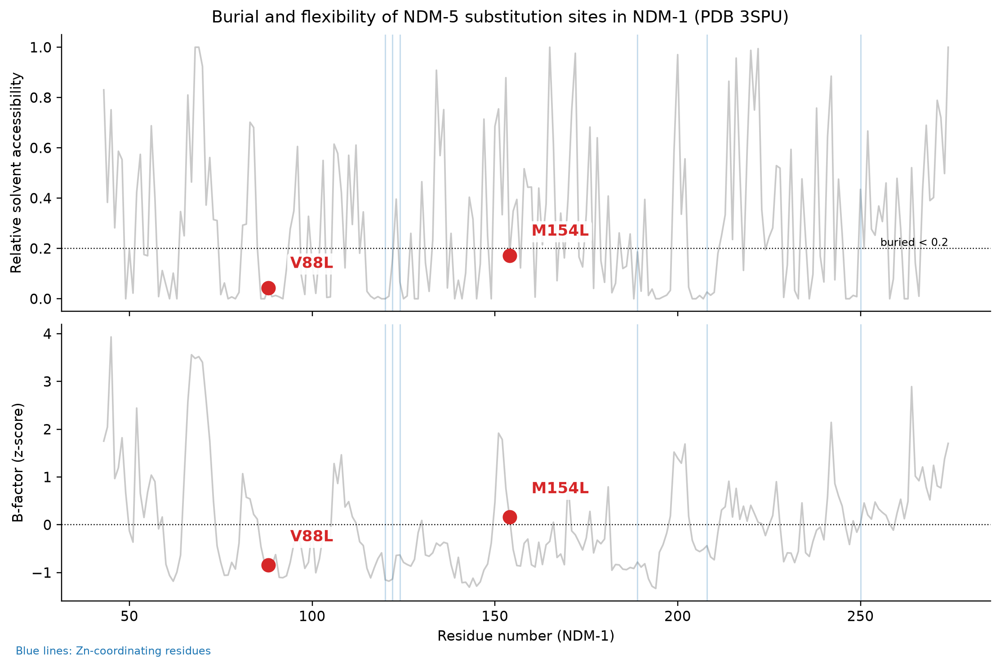
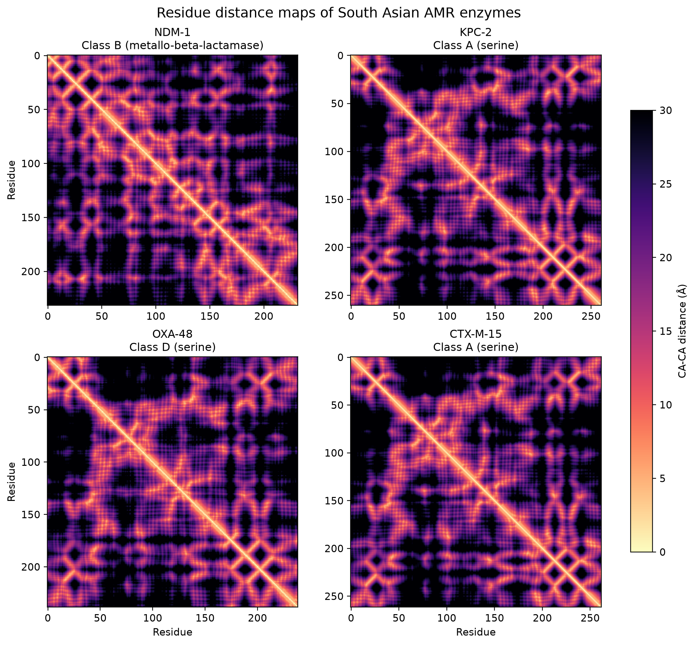

# Structural Analysis of South Asian Carbapenem and ESBL Enzymes

Companion to klebsiella-amr-south-asia. Genomic surveillance showed which
resistance enzymes dominate (NDM, KPC, OXA-48, CTX-M-15); this project
examines their structures.

## Structures (RCSB PDB)
NDM-1 3SPU, KPC-2 2OV5, OXA-48 3HBR, CTX-M-15 4HBT

## Methods
Python (Biopython, NumPy, Matplotlib) run on Termux/Android.
Residue CA-CA distance maps, Zn coordination (2.6 A cutoff), mutation
mapping onto NDM-1, solvent accessibility (Shrake-Rupley, Biopython) and
B-factor z-scores per residue.

## Findings
- KPC-2 and CTX-M-15 (class A) have near-identical distance maps; OXA-48
  (class D) is similar; NDM-1 (class B metallo) differs clearly.
- NDM-1 binds two zinc ions: Zn1 (His120, His122, His189) and
  Zn2 (Asp124, Cys208, His250).
- NDM-5 differs from NDM-1 by V88L and M154L. Mapped onto NDM-1, V88 lies
  15.4 A and M154 9.3 A from the nearest Zn: both are outside the first
  coordination shell.
- V88 is buried (relative SASA 0.04) and rigid (B-factor z = -0.85); M154 is
  nearly buried (SASA 0.17) with average flexibility (z = +0.16). Both
  substitutions replace one hydrophobic residue with another inside the
  protein core, consistent with indirect effects on stability or dynamics
  rather than direct catalytic involvement (hypothesis, not tested here).

## Figures

## Limitations
- NDM-5 was not modeled; mutations were mapped onto NDM-1 (3SPU).
- Structural superposition (RMSD) across enzyme classes was not used because
  sequence alignment is unreliable at low identity.
- Distances, SASA and B-factors come from a single chain of one crystal
  structure; B-factors depend on crystal packing and resolution.

## Reproduce
python fetch_structures.py && python make_figures.py && python burial_flexibility.py
